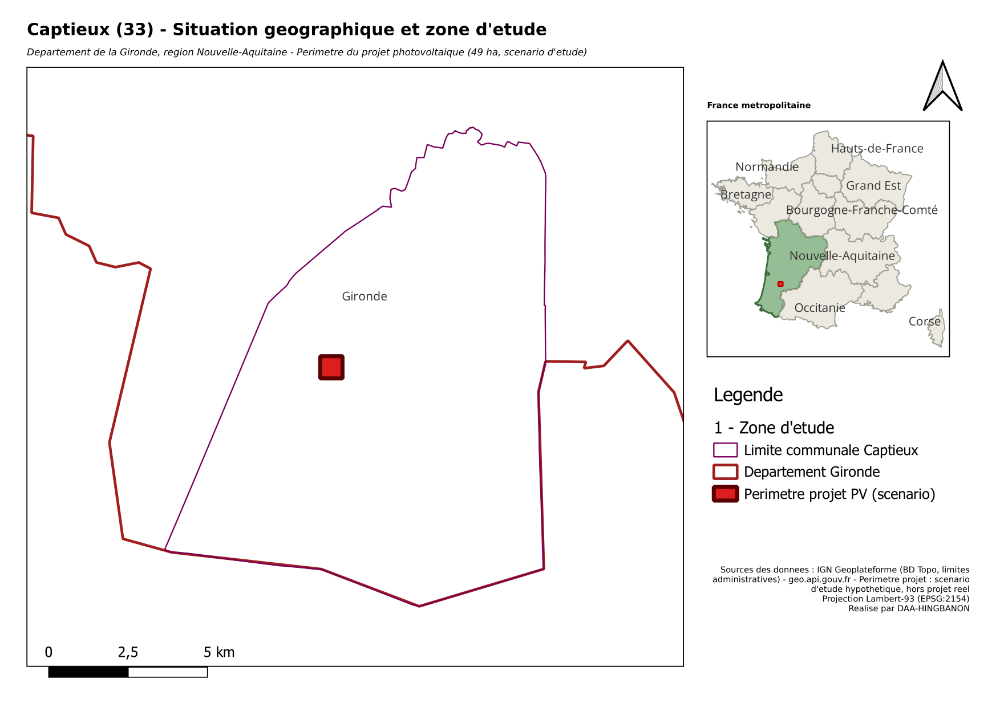
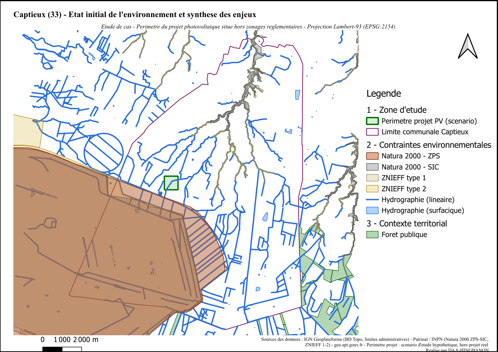
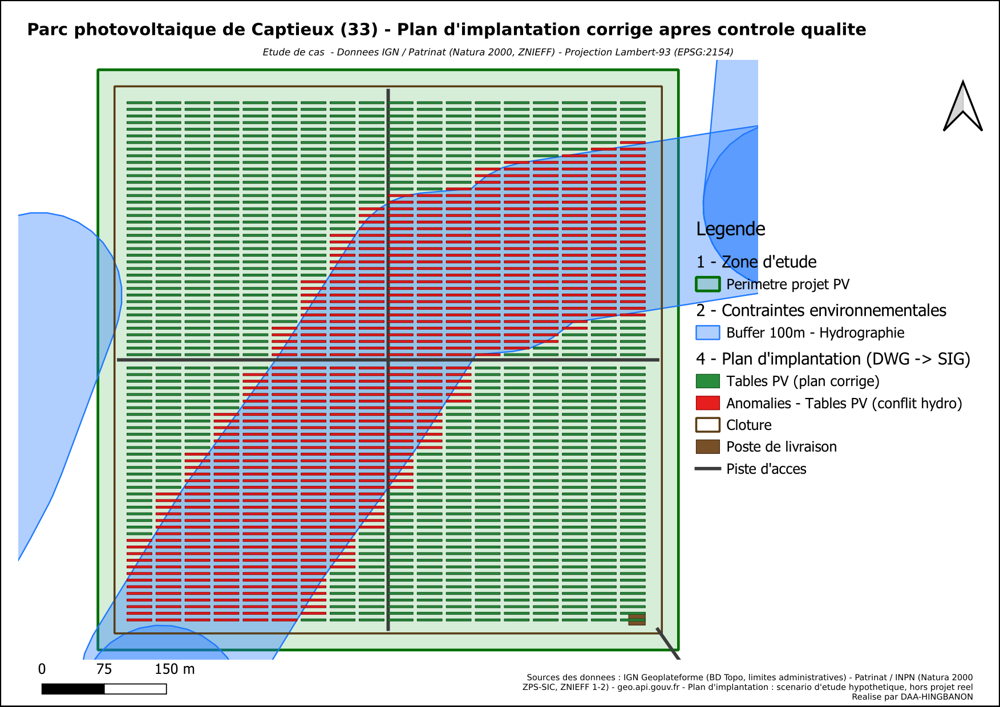

# Étude environnementale d'un parc photovoltaïque à Captieux (Gironde)

Étude de cas SIG de bout en bout : intégration de données environnementales ouvertes, analyse spatiale multicritère, conversion d'un plan CAO (DXF/DWG) en SIG, contrôle qualité, production cartographique et collecte terrain.

**Cadre de l'étude.** Le périmètre du projet (49 ha) et le plan d'implantation sont un **scénario d'étude hypothétique** : aucun projet photovoltaïque n'existe à cet emplacement. En revanche, toutes les données environnementales (Natura 2000, ZNIEFF, hydrographie, forêt, routes, limites administratives) sont réelles et proviennent de sources officielles ouvertes. Seule la méthode d'analyse a vocation à être réutilisée sur un vrai dossier.

## Résultats

| Indicateur | Valeur |
|---|---|
| Périmètre du projet | 49 ha (carré de 700 m), hors zonages réglementaires |
| Distance à la ZPS Natura 2000 | 367 m |
| Cours d'eau | traverse le périmètre |
| Distance aux ZNIEFF type 2 / SIC / route / ZNIEFF type 1 | 963 m / 984 m / 1 058 m / 1 865 m |
| Tables photovoltaïques du plan d'origine | 1 404 |
| Tables en conflit avec la bande de 100 m des cours d'eau | 601 (43 %) |
| Tables conservées dans le plan corrigé | 803 (6,0 ha d'emprise au sol) |

Un site situé en dehors d'un zonage n'est pas pour autant hors de sa zone d'influence : à 367 m d'une ZPS, le projet relève d'une évaluation des incidences Natura 2000, et le cours d'eau impose une bande de recul au titre de la loi sur l'eau.

## Cartes

| | |
|---|---|
|  |  |
| Situation géographique et zone d'étude | État initial de l'environnement (échelle communale) |



*Plan d'implantation après contrôle qualité : tables conservées en vert, tables retirées en rouge.*

Les mises en page sont fournies aussi en PDF dans [`cartes/`](cartes/).

## Chaîne de traitement

1. **Intégration des données** : flux WFS de la Géoplateforme IGN (BD Topo, Patrinat/INPN) et API geo.api.gouv.fr, importés dans PostgreSQL/PostGIS en Lambert-93 (`scripts/01_recuperer_donnees.sh`).
2. **Base de données** : une base `etude_env_captieux` organisée en schémas thématiques (`zone_etude`, `contraintes`, `contexte`, `projet`, `projet_amenagement`). Structure dans [`postgis/structure_base.sql`](postgis/structure_base.sql).
3. **Analyse spatiale multicritère** : zone éligible, zones tampons (500 m autour de la ZPS, 100 m autour des cours d'eau), distances aux six enjeux ([`postgis/analyses.sql`](postgis/analyses.sql)).
4. **Conversion DWG vers SIG** : un plan DXF (1 409 entités) est généré (`scripts/02_generer_plan_dxf.py`), importé (`scripts/03_importer_plan_dxf.sh`), puis corrigé : les entités fermées arrivent en lignes fermées et sont converties en polygones valides.
5. **Contrôle qualité** : détection des tables situées dans la bande de 100 m des cours d'eau, puis plan corrigé.
6. **Cartographie** : trois mises en page QGIS (titre, légende, échelle, orientation, sources).
7. **Collecte terrain** : package QField autonome (voir plus bas).

## Modèles de traitement réutilisables

Le dossier [`outil_processing/`](outil_processing/) rejoue les étapes ci-dessus sous forme de modèles QGIS Processing (`.model3`), à ouvrir dans la boîte à outils (Modèles, puis « Ajouter un modèle depuis un fichier »). Chacun a été exécuté sur les données réelles et redonne les résultats de l'analyse SQL. Il contient aussi les outils FME.

| Fichier | Rôle | Résultat de validation |
|---|---|---|
| `conversion_dwg_vers_sig.model3` | extraction d'un calque DXF, polygonisation, correction des géométries | 1 404 polygones valides pour le calque `TABLES_PV` |
| `controle_qualite_tables_pv.model3` | tampon sur les cours d'eau, tables en conflit / conformes | 601 / 803 |
| `analyse_multicritere_distances.model3` | distance du périmètre à six couches de contraintes | 367 m, 984 m, 1 865 m, 963 m, 0 m, 1 058 m |
| `workflow_dwg_vers_sig.fmw` | point de départ FME : lecteur DXF configuré, écrivain PostGIS | 1 409 entités lues |
| `auto_conversion_dwg_vers_sig.ps1` | script PowerShell qui convertit via FME les plans DXF/DWG du dossier `dwg/` en GeoPackage, uniquement si la source a changé | exécution réussie sur le plan du projet |

Le workspace FME ne contient que la lecture du DXF et l'écriture PostGIS : la connexion à la base et les transformers intermédiaires (filtre par calque, constructeur de polygones, tampon, filtre spatial) restent à ajouter dans Workbench.

## Collecte terrain (QField)

[`qfield/`](qfield/) contient un GeoPackage autonome (périmètre, plan corrigé, anomalies, clôture, piste, zone tampon) et un projet QGIS prêt pour QField, avec une couche de relevé (date, observateur, type d'observation, commentaire, photo) et trois exemples de points à vérifier sur site. Copier le dossier sur l'appareil et ouvrir `terrain_captieux_qfield.qgz`.

## Reproduire le projet

Prérequis : PostgreSQL 15 avec PostGIS, GDAL (`ogr2ogr`), `curl` et Python 3 ; QGIS 3.34 pour les cartes. Sous Windows, lancer les scripts depuis un shell dont le `PATH` contient `QGIS/bin` avant `PostgreSQL/bin` (deux versions de PROJ cohabitent et se perturbent).

```bash
export PGUSER=postgres PGPASSWORD=... PGDATABASE=etude_env_captieux
createdb etude_env_captieux
bash scripts/01_recuperer_donnees.sh
python scripts/02_generer_plan_dxf.py
bash scripts/03_importer_plan_dxf.sh
psql -v ON_ERROR_STOP=1 -f postgis/analyses.sql
bash scripts/04_contexte_carte_situation.sh   # contours département et régions (carte de situation)
```

La chaîne a été rejouée sur une base vierge : elle redonne exactement 1 404 / 601 / 803 tables et les mêmes distances que dans les résultats ci-dessus.

Le projet QGIS complet est dans [`qgis/etude_env_captieux.qgz`](qgis/etude_env_captieux.qgz). Il se connecte à la base `etude_env_captieux` sur `localhost:5432` et demande l'identifiant et le mot de passe PostgreSQL à l'ouverture (aucun identifiant n'est enregistré dans le dépôt).

## Sources des données

| Donnée | Source |
|---|---|
| Natura 2000 (ZPS, SIC), ZNIEFF type 1 et 2 | Patrinat / INPN, via la Géoplateforme IGN (WFS) |
| Hydrographie, forêt publique, routes, départements, régions | IGN BD Topo, via la Géoplateforme (WFS) |
| Limite communale | API geo.api.gouv.fr |

## Auteur

DAA-HINGBANON
